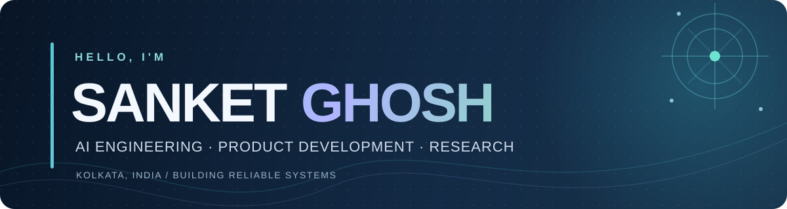

<!-- Profile README for github.com/ghoshsanket. Keep this file in the ghoshsanket/ghoshsanket repository. -->

  

  

<h3 align="center">Building practical software. Investigating reliable AI.</h3>

  
  

  
  
  

---

## 👋 About me

I'm **Sanket Ghosh**, a software and AI developer based in Kolkata, India, working at the intersection of **product engineering, backend systems, agentic AI, and applied research**. I have **2+ years of industry experience** across overlapping software and AI roles, along with research and technical leadership experience.

- 🎓 **B.Tech in Computer Science & Engineering**, Institute of Engineering & Management (IEM), Kolkata, **2022–2026** · **CGPA 9.14/10**.
- 🏗️ **Industry:** Built FastAPI services, document-processing pipelines, AI workflows, marketing automation integrations, and data-driven applications.
- 🔬 **Research:** Interested in trustworthy and explainable AI, evidence-grounded generation, uncertainty, and financial time-series modelling.
- 🤝 **Community:** Former Student Industry Lead at IEM's Generative AI Centre of Excellence; also served as a cloud-computing teaching assistant.
- 🌏 **Collaboration:** Open to research collaborations and small, clearly scoped software/AI development projects with Indian and international teams.

<table>
<tr>
<td width="50%" valign="top">

### 💼 Industry & engineering

**[Explore my industry portfolio →](https://www.sanketghosh.dev/)**

Websites, AI chatbots, Python automation, backend APIs, and integration work. Includes **clearly labelled interactive concept demos**, not invented client engagements.

</td>
<td width="50%" valign="top">

### 🔬 Research & academia

**[Explore my research portfolio →](https://ghoshsanket.github.io/)**

Publications, current research interests, experimental AI systems, and academic background.

</td>
</tr>
</table>

---

## 🧰 Technical ecosystem

### 🧠 Generative AI & machine learning

  
  
  
  
  
  

### ⚙️ Backend, data & automation

  
  
  
  
  
  
  
  

### ☁️ Cloud, web & developer tooling

  
  
  
  
  
  
  

---

## 💼 Professional experience

| Period | Organization & role | Selected contributions |
|:--|:--|:--|
| **Dec 2025 – Apr 2026** | **Quantyra Analytics** · Product Engineer (internship) | Worked on **Marketing4Sight**, a marketing-automation product using FastAPI, Node.js, AWS, Google business/analytics integrations, and AI-enabled workflows. |
| **Jan 2025 – May 2026** | **Humanizetech.ai** · AI Practice Intern | Developed FastAPI document-processing and test-generation services; LangChain/LangGraph and RAG workflows; SAP **BPML** and ServiceNow automation; audit logging with AWS Lambda and MongoDB. |
| **Jul 2024 – Dec 2024** | **Bair.ai** · Software Developer Intern | Built financial time-series and sentiment-processing pipelines, including LSTM and meta-learning experiments. |
| **Nov 2024 – Mar 2026** | **GenAI Centre of Excellence, IEM** · Student Industry Lead | Mentored teams and contributed to SaaS-oriented initiatives such as HR analytics, automated content generation, meeting transcription, and wireframe-to-code tools. |
| **Jul – Sep 2025** | **IEM** · Cloud Computing Teaching Assistant | Supported practical cloud labs covering AWS, Docker, deployment, and virtualization for approximately **230 students**. |

*Some roles overlap. Professional employment, academic leadership and research are described separately rather than counted as sequential full-time positions.*

### 🧩 Selected engineering work

- **Marketing4Sight:** Product engineering on a marketing-automation platform with business-service integrations.
- **Document intelligence & automation:** FastAPI-based document processing, test-case generation from requirements, LLM workflows and tool orchestration.
- **Student-led SaaS initiatives:** HR analytics, content generation, meeting summarization, and wireframe-to-code experimentation under the IEM GenAI CoE.

**Try three public, self-initiated demos** (fictional businesses; not paid client projects): [FAQ assistant](https://www.sanketghosh.dev/solutions/ai-assistant) · [business website](https://www.sanketghosh.dev/solutions/business-website) · [order-data automation](https://www.sanketghosh.dev/solutions/workflow-automation).

---

## 🔬 Research directions

My work explores how to make AI systems **more reliable, interpretable, and useful**, especially when they depend on uncertain data or retrieved evidence.

- **Evidence-Gated RAG:** Investigating how retrieval-augmented systems handle conflicting, correlated, and insufficient evidence. Experimental work uses hybrid dense/sparse retrieval over a **28,482-document TechQA corpus**.
- **Tool-using AI agents:** Studying routing, validation, and failure behavior in multi-tool workflows, including KAN-Route experiments with **16- and 35-tool settings**.
- **Explainable financial forecasting:** Machine learning, sentiment signals, agentic pipelines, and interpretable outputs for financial time-series studies.
- **Uncertainty quantification:** Ongoing work involving conformal methods and reliability of predictions under changing data conditions.

These describe research projects and areas of investigation; they are **not claims of publication or independently validated results**.

### 📚 Publications

**Published / listed as published in my current résumé**

1. **The COVID-19 Shock: An Analysis of Impacts and Responses of Indian Stock Market** — *International Conference on Interdisciplinary Research in Technology and Management (IRTM), 2024*.
2. **Machine Learning-Driven Insights for Stock Market Analysis and Trading** — *IRTM, 2024*.
3. **Explanation-First Agentic Forecaster for Stock Market** — *IEMENTech, 2026*.

**Submitted**

- **Multi-modal Framework for Memecoin Price Prognostication using Portfolio Risk-aware Independent Set Meta-learning (PRISM) Approach** — submitted to *Computational Economics* (July 2026, per résumé).

**In progress**

- **MiQ-MCP: Valid and Conditionally Robust Uncertainty Quantification for High-Frequency Financial Time Series via Mondrian Conformalized Quantile Regression**.

For detailed research information and publication updates: **[ghoshsanket.github.io](https://ghoshsanket.github.io/)**.

---

## 🧭 Current focus

- Deliver useful, carefully scoped **AI, automation, website and backend solutions**.
- Develop **trustworthy AI agents** that can recognize limited or conflicting evidence.
- Improve **software engineering quality** through testing, reproducible experiments and documented handoffs.
- Continue publishing and collaborating on **applied machine learning and dependable AI systems**.

---

## 📊 GitHub contributions & activity

  

  

Live widgets are generated from the public <a href="https://github.com/ghoshsanket">@ghoshsanket</a> account; private contributions may not be visible. Third-party image services can occasionally be unavailable.

---

## 🌐 Connect & collaborate

  
  
  
  

<i>Curious about the research? Visit the academic portfolio. Have a software problem to solve? Start with the industry portfolio.</i>

